## Problem statement

People in India who hold two or more credit cards lose money quietly. An
annual fee that could have been waived goes through because spend fell
short by a few thousand rupees. Points lapse unseen. A bank cuts an earn
rate or gates a lounge benefit, and the notice sits on a page nobody reads.
None of this is a lack of information: the terms are all published. It is
that nobody turns those terms into **one rupee figure for the cards this
person actually holds, on their own spend, with time left to act**.

Clutch is an honest friend for that. It tells a cardholder, in rupees, what
their cards are quietly costing them, which of their own cards to use for a
payment, and what a bank's rule change means for them.

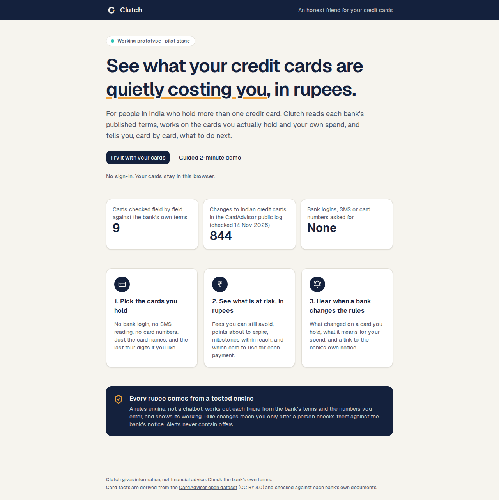

[](https://github.com/Asha0509/Clutch_MVP/actions/workflows/ci.yml)
Typecheck, lint, unit tests, Firestore security-rules tests and the
catalogue check run on every push.

**Status:** a working, pilot-stage prototype. 9 credit cards checked
field by field against each bank's own terms. No sign-in: anyone can open it
and use it on their own cards. No users yet; revenue Rs 0. Full spec:
[docs/prd.md](docs/prd.md).

### Try it with your cards

Press **Try it with your cards** on the landing page. One question (birth
year and month; under-18s are turned away and nothing is stored), then:

1. **My cards.** Pick from the catalogue and add what you know: fee month,
   spend so far, points and their expiry date, statement and due days, and a
   typical month of spend by category. Or press **Fill with an example**.
2. **Checkup.** Rupees at risk across your cards, the fixes to do first, and
   **How we worked out Rs X**: the engine's arithmetic for every rupee.
   Fee-waiver, milestone and lounge bars, due dates and points expiry per card.
   It recomputes as you edit.
3. **Pay with.** Category, amount, card or UPI: your best card, the runner-up,
   and the cards that cannot take the payment.
4. **Verdict.** Keep, downgrade or close, from your own typical month.
5. **Founder console.** The live public change log of Indian credit cards,
   cut to the cards Clutch covers. Approve a change (with its notice link and
   the before and after) and it is priced on your spend and appears on a
   checkup open in another tab, without a reload.

Your data stays in your browser. **Download my data** and **Clear my data**
are on My cards.

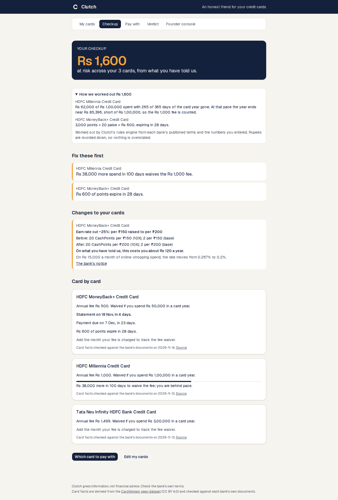

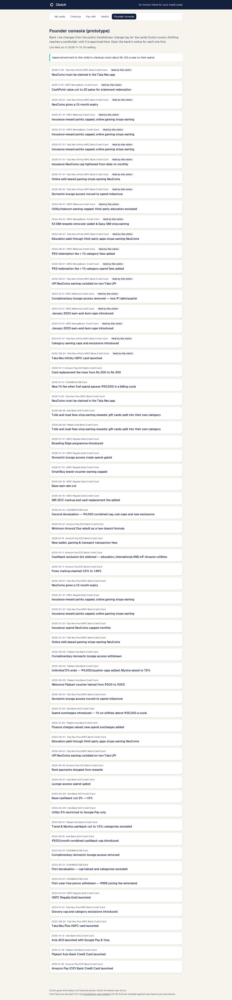

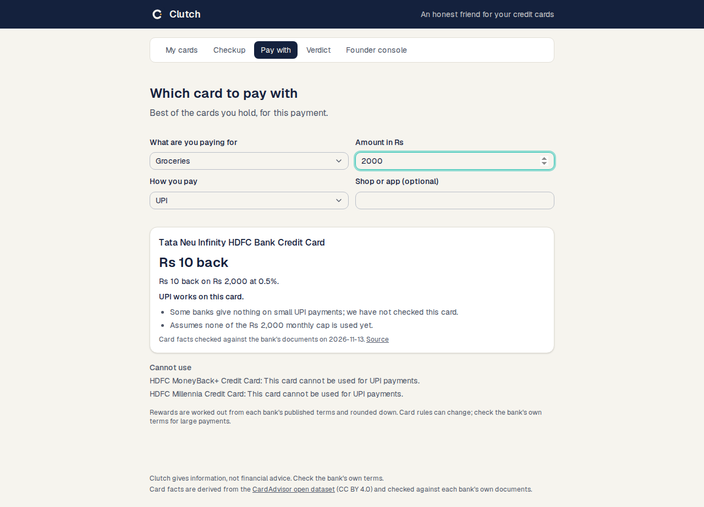

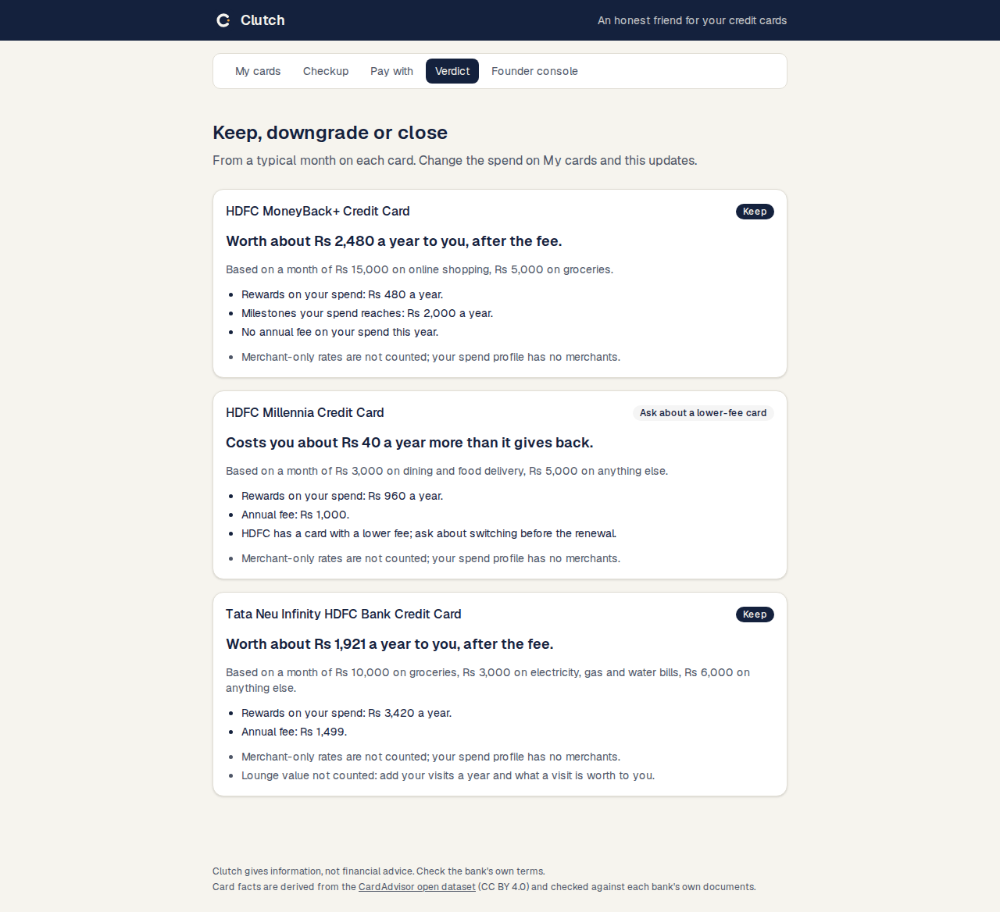

Mobile first (checked at 375px and 1280px):


### Or take the guided 2-minute demo

**Guided 2-minute demo** walks a made-up person with three real cards
through five screens, with presenter notes, and works with Wi-Fi off.

| Step                                            | Screen                                     |
| ----------------------------------------------- | ------------------------------------------ |
| 1. Checkup: Rs 1,600 at risk                    |    |
| 2. A real change, priced at about Rs 120 a year | 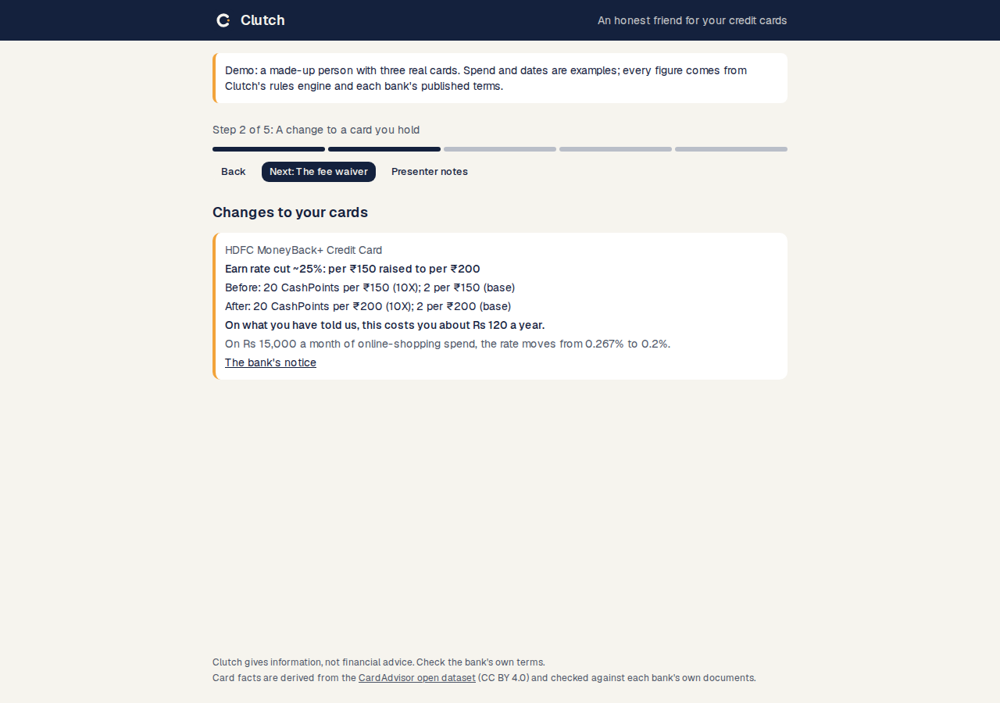   |
| 3. Rs 38,000 more in 100 days waives the fee    | 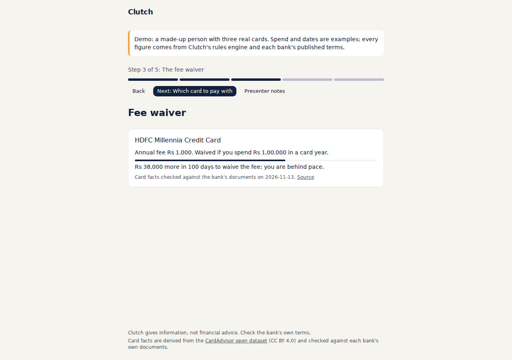 |
| 4. Only the RuPay card takes UPI                |       |
| 5. Keep, downgrade, keep                        | 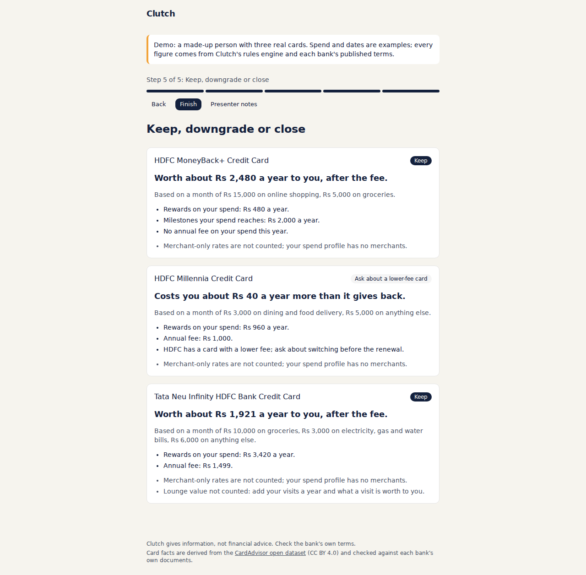   |

**Contents:** [Problem](#problem-statement) · [Solution](#solution) · [File structure](#file-structure) · [User flow](#user-flow) · [LLD](#low-level-design-lld) · [HLD](#high-level-design-hld) · [Scaling](#how-it-would-scale) · [USP](#usp-what-is-different-and-why-it-is-better) · [Tools](#tools-and-software-used) · [Principles](#principles-used) · [Requirements](#functional-and-non-functional-requirements) · [Results](#results) · [Real and made up](#whats-real-and-whats-made-up) · [Known gaps](#known-gaps) · [Docs](#docs-tests-and-logs--where-everything-is) · [CI](#engineering-quality-and-ci) · [Setup](#setup)

### Why the usual answers miss this

- **Card comparison sites** rank cards in general. They do not know which
  cards you hold or how much you spend, so they cannot say what a change
  costs _you_.
- **Change trackers** (for example the CardAdvisor public change log, which
  records 844 distinct changes to Indian credit cards, checked 14 Nov 2026)
  say that a rule changed. They do not price it on your spend or tell you
  which of your cards to switch to.
- **Apps that read your SMS, email or bank login** can see more, but ask for
  access many people will not give. Clutch asks only for card names.

## Solution

A rules engine over a hand-checked card catalogue, and a working app around it.

- **Deterministic where money is involved.** Every rupee figure comes from
  `src/engine/`: pure TypeScript, no network, no clock, no randomness
  (enforced by a lint rule). Integer rupees, rounded down so a saving is
  never overstated.
- **Shows its working.** Every rupee at risk comes with the arithmetic
  behind it, written by the engine, not typed into the copy.
- **Facts from the bank, not from memory.** Each card field is checked
  against the bank's own terms, with page references in
  `data/catalogue/checklist.md`. Unknown fields stay `null` rather than
  guessed.
- **A human approves every change alert.** The public change log is read
  live and every entry waits as _pending_. The Founder approves each one
  against the bank's notice; only then is it priced on each holder's own
  spend and delivered.
- **The language model never computes money.** Gemini is planned only for
  reading user text and wording alerts from facts the engine already
  computed.
- **No sensitive access.** No sign-in, no bank login, no SMS or email
  reading, no card numbers. Last four digits are optional. In the
  prototype everything stays in the visitor's browser.

**What the engine computes** (`src/engine/`): best card for a payment
(including UPI on RuPay credit cards) · fee-waiver, milestone and lounge pace
· points expiry · statement and due dates · rupees at risk, with its working
· keep, downgrade or close verdict · rupee impact of a rule change on a
person's spend.

## File structure

Every tracked file, one line each. shadcn/ui primitives in
`src/components/ui/` and the app icons in `public/icons/` are listed as
folders only.

```text
Clutch_MVP/
├── README.md                          this file
├── CLAUDE.md                          engineering constraints that governed the build
├── AGENTS.md                          Next.js agent notes (written by next dev)
├── setup.sh                           idempotent dev-machine setup (./setup.sh --help)
├── package.json, pnpm-lock.yaml, pnpm-workspace.yaml   app + functions workspace
├── next.config.ts, tsconfig.json, components.json, eslint.config.mjs
├── vitest.config.ts, vitest.rules.config.ts            unit tests; security-rules tests
├── playwright.config.ts               e2e on the production build (prototype, demo, offline, video)
├── firebase.json, firestore.rules, firestore.indexes.json   pilot backend design (rules tested)
├── .mcp.json                          Playwright MCP (headless) for UI checks
├── .claude/                           reviewer agent, rules for engine and UI work, hooks
├── .github/workflows/ci.yml           typecheck, lint, unit, rules, catalogue check
├── data/
│   ├── catalogue/
│   │   ├── catalogue.json             9 verified cards, validated with zod on load
│   │   ├── draft.json                 cards not yet verified (never shown to users)
│   │   ├── checklist.md               every field, its source document and page
│   │   └── ATTRIBUTION.md             CardAdvisor dataset credit (CC BY 4.0)
│   ├── feed/snapshot.json             saved copy of the change log for the 9 cards (offline fallback)
│   └── fixtures/                      change-feed test sample, with its provenance
├── src/
│   ├── engine/                        the rules engine: pure, no I/O
│   │   ├── types.ts                   zod schemas: Card, RewardRule, UserCard, Spend, Change
│   │   ├── rewards.ts                 rule for a spend, reward in rupees, caps, point value
│   │   ├── bestCard.ts                rank the user's own cards for one payment
│   │   ├── progress.ts                fee-waiver and milestone progress and pace
│   │   ├── expiry.ts                  points-expiry reminders (60, 30, 7 days)
│   │   ├── due.ts                     statement and payment due dates (5, 2, 0 days)
│   │   ├── checkup.ts                 rupees at risk, the fixes to do first, and the working
│   │   ├── verdict.ts                 keep / downgrade / close from a spend profile
│   │   ├── impact.ts                  rupee effect of a rule change on a person's spend
│   │   ├── dates.ts                   card year and calendar periods (today passed in)
│   │   └── format.ts                  formatRs, used only at the edge
│   ├── lib/
│   │   ├── local-store.ts             the visitor's data in the browser: zod-checked, shared across tabs, approve()
│   │   ├── feed.ts                    change log to pending alerts (shared with the Cloud Function)
│   │   ├── demo.ts, demo-steps.ts     the example person (dates relative to today) and demo step copy
│   │   ├── catalogue.ts, held.ts      load the catalogue; join user cards to card facts
│   │   ├── age.ts, notice.ts          under-18 rule; consent purposes of the pilot design
│   │   └── alert-copy.ts, labels.ts, utils.ts
│   ├── components/
│   │   ├── views/                     pure views shared by the prototype and the demo
│   │   ├── screens/                   prototype screens on browser storage, and the age gate
│   │   ├── demo/                      demo banner, stepper, presenter notes
│   │   ├── app-nav.tsx                prototype navigation
│   │   ├── sw-register.tsx            service worker (production only, for the offline demo)
│   │   └── ui/                        shadcn/ui components
│   └── app/
│       ├── page.tsx                   landing page
│       ├── start/                     age check
│       ├── (app)/                     cards, checkup, pay, verdict, admin (Founder console)
│       ├── api/changes/route.ts       live change log, cut to the catalogue, cached for an hour
│       ├── demo/                      the 5-step guided demo
│       └── manifest.ts, layout.tsx, globals.css
├── functions/src/                     Cloud Functions for the pilot: daily feed ingest, admin-only approval, email
├── public/sw.js, public/icons/        offline cache for the demo; app icons
├── scripts/
│   ├── check-catalogue.ts             validate the catalogue (pnpm catalogue:check)
│   ├── make-admin.ts                  set the admin claim (pilot design)
│   └── screens.mjs                    regenerate the screenshots in docs/images
├── tests/
│   ├── engine/                        engine tests, expected rupees worked by hand in comments
│   ├── lib/                           browser store, feed, demo data, age rule
│   ├── functions/                     alert email
│   ├── rules/firestore.test.ts        29 security-rules tests in the emulator
│   └── e2e/                           prototype, demo (with offline), and the video recording
├── docs/
│   ├── prd.md                         full specification
│   ├── research-summary.md            market research verdict and sources
│   ├── demo-script.md                 talk track and honest answers
│   ├── build-log.md                   append-only: what failed, the cause, the fix
│   └── images/                        screenshots used in this README
└── logs/.gitkeep                      JSONL run logs land here (git-ignored)
```

### How the files connect

Arrows mean "imports" or "reads". The engine imports nothing outside itself
(enforced by a lint rule).

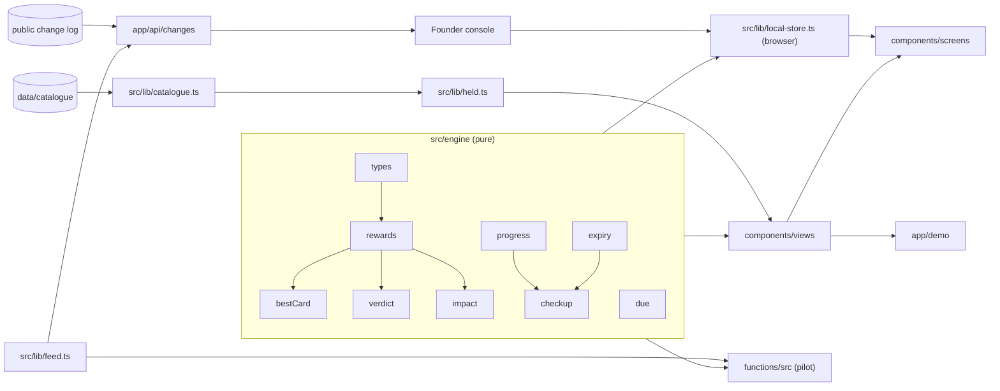

## User flow

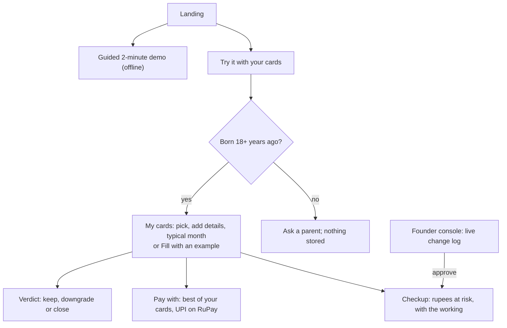

**Explanation.** A visitor answers one age question and goes straight to
their cards; nothing needs an account. Every screen reads the same
browser-held data and recomputes with the engine as it changes. The Founder
console is the other side of the product: a real bank change is approved
there and lands, priced, on the visitor's checkup.

## Low-level design (LLD)

How one rule change reaches a cardholder in the prototype:

```mermaid
sequenceDiagram
    participant F as CardAdvisor change log
    participant R as /api/changes (server)
    participant C as Founder console
    participant S as local-store (browser)
    participant E as src/engine
    participant U as Checkup (other tab)
    C->>R: GET pending changes
    R->>F: fetch (cached 1 hour; saved copy if offline)
    R->>R: zod-validate, keep the 9 catalogue cards
    R-->>C: pending changes, newest first
    C->>C: Founder opens the bank notice, enters before and after, ticks "checked"
    C->>S: approve(change)
    S->>E: impactOfChange(card, change, visitor's typical month)
    E-->>S: rupees per year (integer, rounded down) and explanation
    S-->>U: storage event
    U->>U: re-render: the change, its rupee effect, the bank's notice
```

**Explanation.** The feed is a trigger, never a sender. The server route
reads the live public log, validates every entry and keeps only cards in
the catalogue. Nothing reaches the visitor until the Founder approves it.
Approval prices the change with the same engine the screens use, on the
visitor's own spend, and a checkup open in another tab updates at once.
Approving twice sends once. For the pilot, the same steps run in
`functions/src` against Firestore, with the admin claim checked on the
server and email to users who consented.

Key engine functions: `checkup()`, `bestCard()`, `waiverProgress()`,
`milestoneProgress()`, `expiryReminders()`, `dueDates()`, `verdict()`,
`impactOfChange()`, `rewardRs()`, `formatRs()`.

## High-level design (HLD)

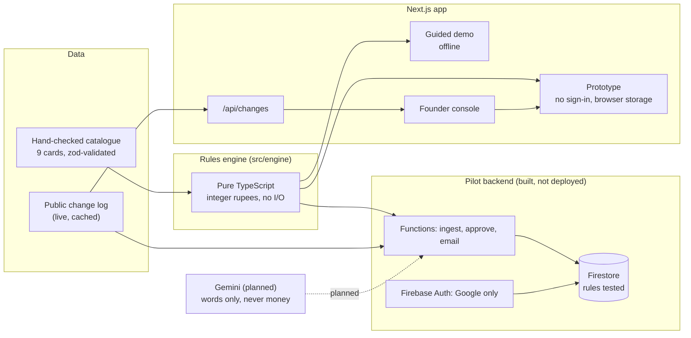

**Explanation.** The catalogue and the engine are the core, used by every
surface. The prototype keeps each visitor's data in their browser and reads
the live change log through one server route. The pilot backend (sign-in,
Firestore with tested security rules, Cloud Functions for ingest, approval
and email) is built and tested on emulators and comes in when real users
sign up. The language model stays off the money path.

## How it would scale

| Concern         | Today                                                                      | Next step                                                                                          |
| --------------- | -------------------------------------------------------------------------- | -------------------------------------------------------------------------------------------------- |
| Card coverage   | 9 cards verified by hand                                                   | The other 21 most-held cards, same checklist; a second reviewer per card                           |
| Change handling | Live feed, Founder approves each change                                    | Same approval, with a diff view against the bank notice and a 72-hour target                       |
| Users           | None; prototype on a laptop, data in the browser                           | 4-week pilot of 20 to 50 people (PRD Sec 12) on the Firebase backend, with sign-in                 |
| Fan-out         | One browser per approval in the prototype; per-user loop in `approveAlert` | Batched writes or a task queue once users number in thousands; the engine needs no change          |
| Channels        | In-app reminders on the checkup; email built for the pilot                 | Web push                                                                                           |
| Input           | Card names and numbers typed by the user                                   | Statement PDF parsed in the browser; the PDF and password never leave the device                   |
| Language        | None                                                                       | Gemini to read free text and word alerts, with output rejected if it has a number not in its input |

## USP: what is different and why it is better

| Feature        | Common approach                  | What Clutch does                                                                   |
| -------------- | -------------------------------- | ---------------------------------------------------------------------------------- |
| Unit of advice | Ratings and "best cards" lists   | Rupees, for the cards this person holds, on their spend                            |
| Trust          | A figure with no explanation     | The arithmetic behind every rupee, from the engine                                 |
| Rule changes   | A news item or a generic alert   | Priced per person, approved by a human, linked to the bank's notice                |
| Data access    | Bank login, SMS or email reading | Card names only; no card numbers, no bank credentials, no sign-in in the prototype |
| Money maths    | Often a model or a spreadsheet   | A pure, tested engine; integer rupees rounded down                                 |
| Card facts     | Scraped or from memory           | Each field checked against the bank's own document, unknowns left blank            |
| Incentives     | Offers inside alerts             | Alerts never contain offers; any future referral is user-initiated and labelled    |

## Tools and software used

| Tool                                                     | Used for                                                           | Why                                                        |
| -------------------------------------------------------- | ------------------------------------------------------------------ | ---------------------------------------------------------- |
| **Next.js 16 (App Router), React 19, TypeScript strict** | App, demo and the change-log route                                 | One codebase; Server Components by default                 |
| **Tailwind 4, shadcn/ui on Base UI**                     | UI                                                                 | Accessible components with semantic colour tokens          |
| **zod 4**                                                | Every external input: catalogue, feed, browser storage, user input | Bad data fails at the boundary, not in a rupee figure      |
| **Firebase Auth, Firestore, Cloud Functions**            | Pilot backend: sign-in, user data, ingest, approval, email         | Google sign-in only; security rules tested in the emulator |
| **Vitest, @firebase/rules-unit-testing**                 | Unit, property and security-rules tests                            | Fast, runs in CI                                           |
| **Playwright**                                           | End-to-end tests, offline demo test, demo video, screenshots       | Checks the real built app at 375px and 1280px              |
| **ESLint (custom engine rules), Prettier**               | Code quality                                                       | The engine purity rule is enforced, not a convention       |
| **GitHub Actions**                                       | CI                                                                 | Every push is checked                                      |
| **pnpm workspaces**                                      | App and functions packages                                         | One lockfile; functions bundle the same engine             |

## Principles used

- **Deterministic money.** Every rupee figure is engine output. No model, no float.
- **Show the working.** The arithmetic behind a figure is shown next to it.
- **Never overstate.** Integer rupees, rounded down; unknown facts left blank, not guessed.
- **Human in the loop for alerts.** A feed entry is a trigger only; nothing reaches a user until the Founder approves it.
- **Least data.** No card numbers, CVV, bank logins, SMS or email access; in the prototype, nothing leaves the browser except the request for the public change log.
- **Under-18s are turned away** before anything is stored.
- **Plain words.** No promised savings, no "best card in India" (PRD Sec 2.1).
- **Keep a build log.** Real failures and fixes are recorded in `docs/build-log.md` as they happen.

## Functional and non-functional requirements

**Functional**

| Requirement                                       | How it is implemented                                                              |
| ------------------------------------------------- | ---------------------------------------------------------------------------------- |
| Show what is at risk, in rupees, with the working | `src/engine/checkup.ts` over expiry, waiver and milestone progress                 |
| Pick the best of your own cards for a payment     | `src/engine/bestCard.ts`, including UPI on RuPay credit cards                      |
| Track fee waivers, milestones and lounge spend    | `src/engine/progress.ts` with pace against days left                               |
| Remind about points expiry and due dates          | `src/engine/expiry.ts` (60, 30, 7 days), `src/engine/due.ts` (5, 2, 0 days)        |
| Price a bank's rule change for one person         | `src/engine/impact.ts`                                                             |
| Keep, downgrade or close                          | `src/engine/verdict.ts`                                                            |
| Alert on changes only after human approval        | `/admin` and `src/lib/local-store.ts` (`approve`); pilot: `functions/src/index.ts` |
| Export and delete your data                       | "Download my data" and "Clear my data" on My cards                                 |
| Show it to investors without setup                | `/start` (own cards) and `/demo` (offline after one visit)                         |

**Non-functional**

| Quality              | Target                                        | How it is checked                                                                                  |
| -------------------- | --------------------------------------------- | -------------------------------------------------------------------------------------------------- |
| Correctness of money | Hand-worked figures                           | Engine tests with the arithmetic in a comment above each assertion                                 |
| Purity of the engine | No I/O, clock or randomness                   | ESLint rule in `eslint.config.mjs`, run in CI                                                      |
| Untrusted input      | Bad data never reaches a figure               | zod on the catalogue, the feed and browser storage; tests for corrupt storage and card numbers     |
| Privacy              | Least data                                    | No sign-in; only an "is an adult" flag, never a birth date; 29 Firestore rules tests for the pilot |
| Live behaviour       | A change approved in one tab shows in another | Playwright two-tab test without a reload                                                           |
| Demo reliability     | Works with no network                         | Playwright test that reloads the demo offline; the feed falls back to a saved copy                 |
| Mobile first         | 375px and 1280px                              | Playwright screenshots, no horizontal scroll                                                       |
| Secrets              | None in code                                  | `.env*` git-ignored and unreadable to the coding agent                                             |

## Results

Latest full run (14 Nov 2026), all green:

| Check                                                                                                  | Result             |
| ------------------------------------------------------------------------------------------------------ | ------------------ |
| Unit tests (engine, browser store, feed, functions, demo data)                                         | 119 passed, 1 todo |
| Firestore security-rules tests (pilot design)                                                          | 29 passed          |
| End to end on the production build: age gate, own cards, two-tab approval, demo with offline, manifest | 5 passed           |
| Typecheck, lint, catalogue check                                                                       | clean              |

The example person's figures, worked by hand in `tests/lib/demo.test.ts`:

| Figure          | Value                                            | Working, as the app shows it                                                     |
| --------------- | ------------------------------------------------ | -------------------------------------------------------------------------------- |
| Rupees at risk  | Rs 1,600                                         | Rs 600 of points + Rs 1,000 fee                                                  |
| Points expiring | Rs 600 in 28 days                                | 3,000 points × 20 paise = Rs 600                                                 |
| Fee waiver      | Rs 38,000 more in 100 days                       | Rs 62,000 of Rs 1,00,000 with 265 of 365 days gone; the pace ends near Rs 85,396 |
| Earn-rate cut   | about −Rs 120 a year                             | Rs 15,000 a month online, 0.267% to 0.2%                                         |
| Verdicts        | Keep Rs 2,480 · Downgrade −Rs 40 · Keep Rs 1,921 | MoneyBack+, Millennia, Tata Neu Infinity                                         |

## What's real and what's made up

- **Real:** the 9 catalogue cards and every rule on them (checked against
  each bank's document, `data/catalogue/checklist.md`); the change log in
  the Founder console (fetched live from the public CardAdvisor log); the
  rules engine and every rupee figure and working line it produces;
  whatever a visitor enters about their own cards.
- **Made up:** the example person ("Fill with an example" and the guided
  demo), their spend and their dates. Dates are set relative to today so
  they never go stale.
- **Not yet:** real users, deployment, push notifications, the language
  model, referral partners. Revenue is Rs 0.

## Known gaps

- **Coverage is 9 cards.** The other 21 most-held cards are not verified
  yet and are not shown.
- **Not deployed.** It runs on a laptop. The pilot backend needs the
  Firebase Blaze plan and a Founder login.
- **Data is per browser.** No account means no sync between devices; that
  comes with sign-in in the pilot.
- **Reminders are in-app only** (due dates, points expiry and waiver pace
  on the checkup); no push or email in the prototype.
- **Pricing a change needs the Founder's structured input** (fee or rate,
  before and after), because the feed describes changes in words.
- **A rule change is priced on the stated rate and category**; accelerated
  merchant rates are not priced separately.
- **Placeholder icon;** brand assets are not final.

## Docs, tests, and logs — where everything is

- **Full specification** — scope, constraints, claims never made (Sec 2.1),
  build order and status (Sec 13). See [docs/prd.md](docs/prd.md).
- **Research** — market verdict, analogues and the pilot gates. See
  [docs/research-summary.md](docs/research-summary.md).
- **Demo script** — talk track, what each screen proves, honest answers to
  likely questions. See [docs/demo-script.md](docs/demo-script.md).
- **Build log** — append-only, dated: what failed, the cause, the fix. See
  [docs/build-log.md](docs/build-log.md).
- **Catalogue provenance** — every card field with its source and page. See
  [data/catalogue/checklist.md](data/catalogue/checklist.md).
- **Feed provenance** — the saved change-log copy and the test sample. See
  `data/feed/snapshot.json` and [data/fixtures/README.md](data/fixtures/README.md).
- **Constraints that governed the build** — hard rules on data, money and
  copy. See [CLAUDE.md](CLAUDE.md).

## Engineering quality and CI

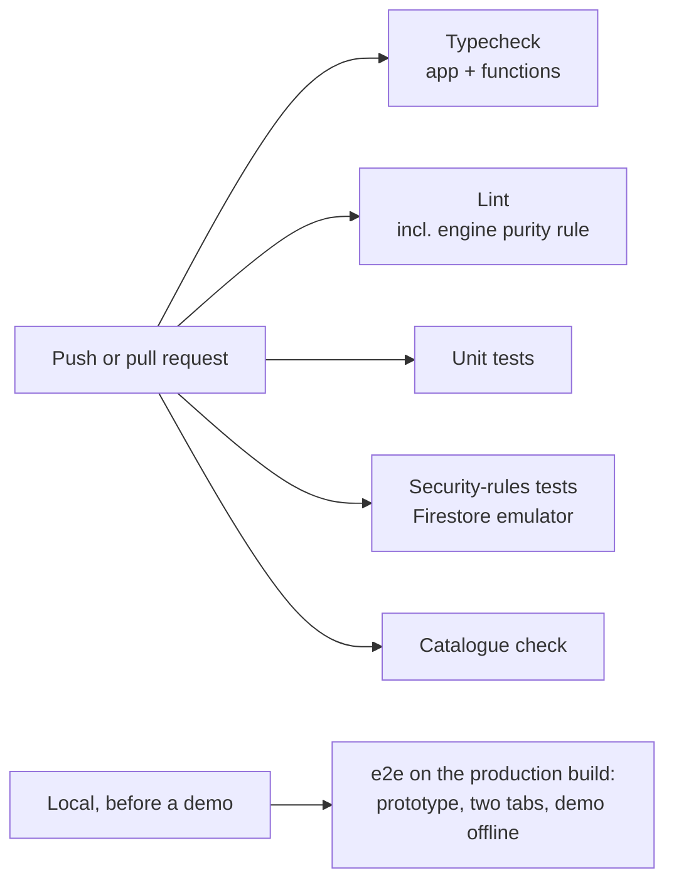

End-to-end tests run locally (they build the app and drive a browser); CI
runs everything else.

## Setup

Needs Node 22 and pnpm.

```bash
pnpm install
pnpm build && pnpm start      # open http://localhost:3000
```

Then **Try it with your cards** (the working prototype) or **Guided 2-minute
demo**. To see a change arrive live, open **Checkup** in one tab and
**Founder console** in another, and approve a change on a card you hold.

```bash
pnpm demo:record                                 # paced walkthrough video: demo-recording/clutch-demo.webm
node scripts/screens.mjs http://localhost:3300   # regenerate docs/images from a running build on port 3300
```

**Tests:**

```bash
pnpm test          # unit tests
pnpm e2e           # end to end on a production build (prototype, demo, offline)
pnpm test:rules    # Firestore security rules of the pilot design (needs Java 21 for the emulator)
pnpm typecheck && pnpm lint
```

## Data and credits

Card facts are derived from the [CardAdvisor open dataset](https://cardadvisor.in/data)
(CC BY 4.0) and checked against each bank's own documents. See
[data/catalogue/ATTRIBUTION.md](data/catalogue/ATTRIBUTION.md). Clutch gives
information, not financial advice.
