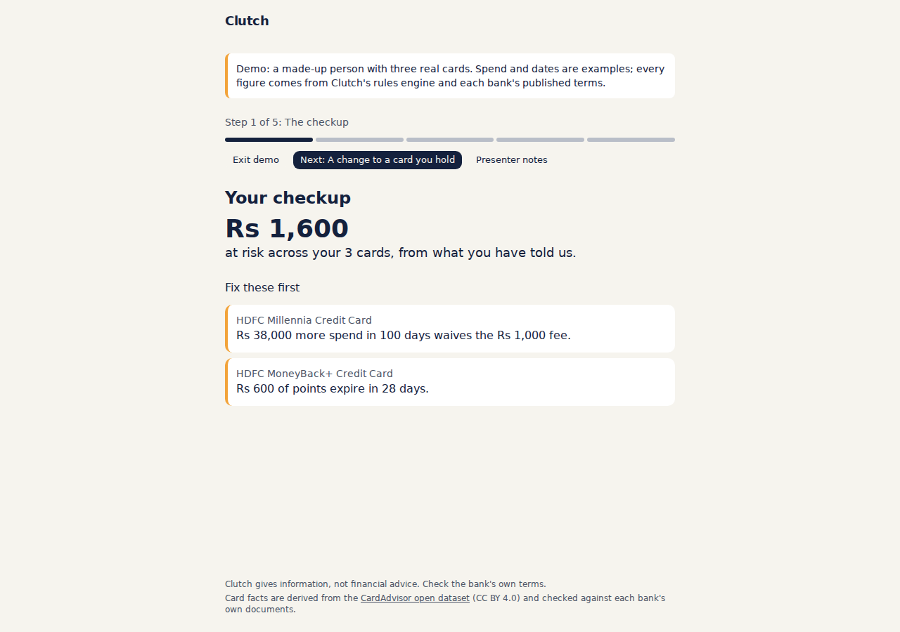
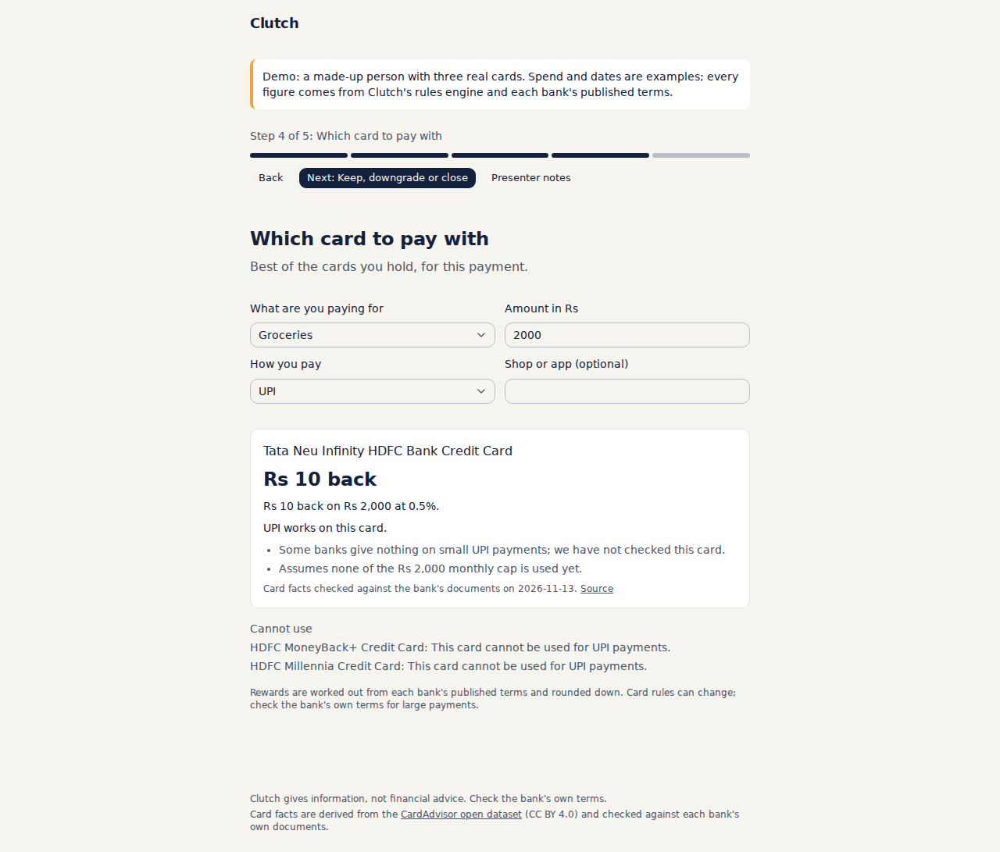
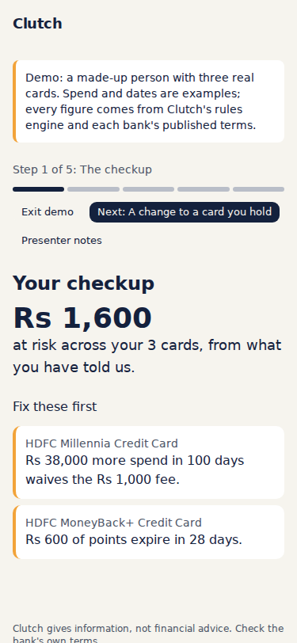
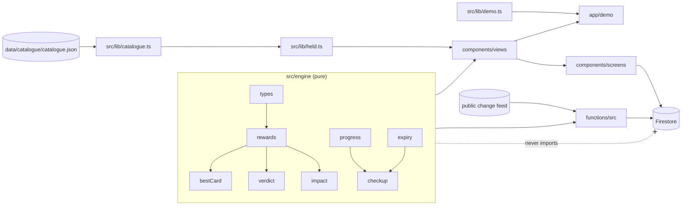
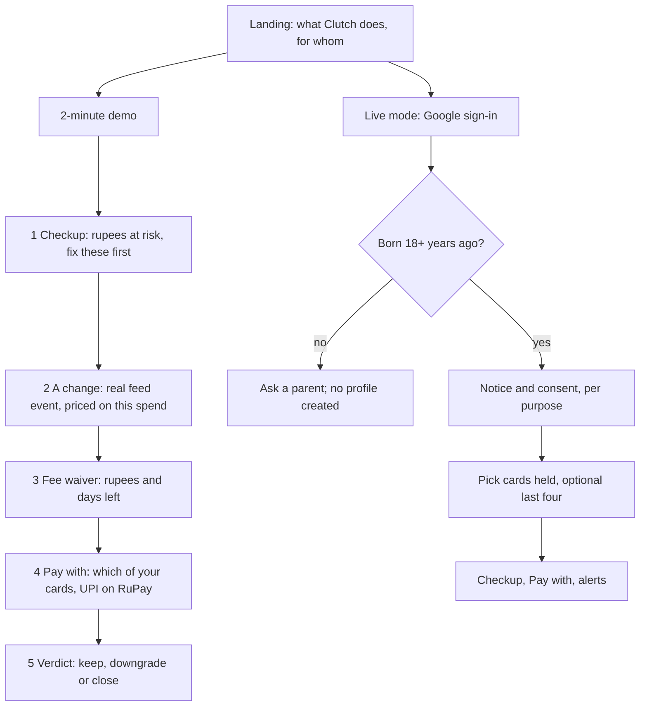
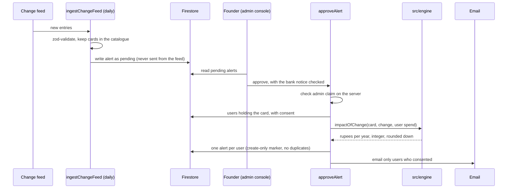
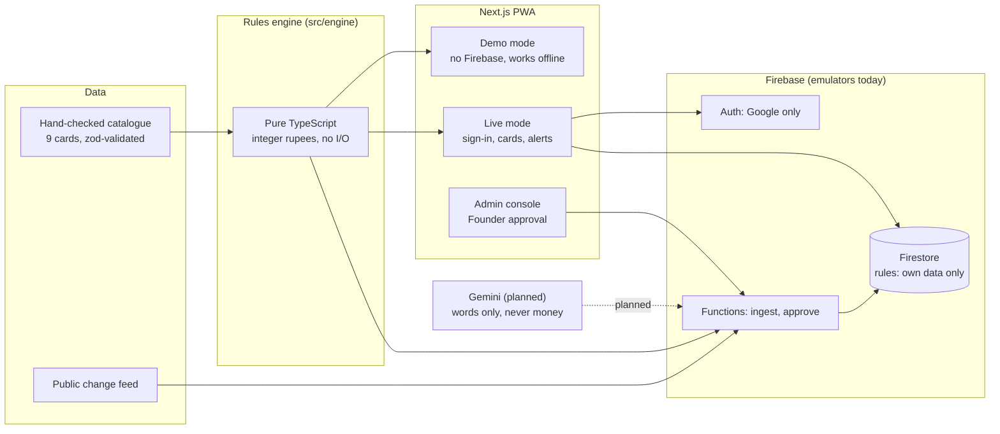
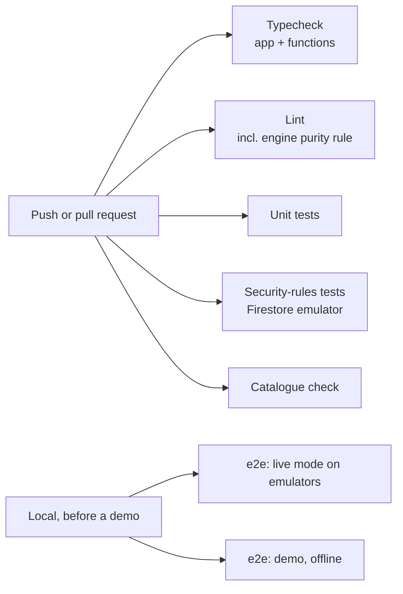

## Problem statement

People in India who hold two or more credit cards lose money quietly. An
annual fee that could have been waived goes through because spend fell
short by a few thousand rupees. Points lapse unseen. A bank cuts an earn
rate or gates a lounge benefit, and the notice sits on a page nobody reads.
None of this is a lack of information: the terms are all published. It is
that nobody turns those terms into **one rupee figure for the cards this
person actually holds, on their own spend, with time left to act**.

Clutch is an honest friend for that. It tells a cardholder, in rupees, what
their cards are quietly costing them, which of their own cards to use for a
payment, and what a bank's rule change means for them.


[](https://github.com/Asha0509/Clutch_MVP/actions/workflows/ci.yml)
Typecheck, lint, unit tests, Firestore security-rules tests and the
catalogue check run on every push.

**Status:** pilot-stage MVP built for investor showcase. 9 credit cards
checked field by field against each bank's own terms. No users yet;
revenue Rs 0. Full spec: [docs/prd.md](docs/prd.md).

### Take the 2-minute demo

Press **See the 2-minute demo** on the landing page. A made-up person holds
three real cards (HDFC MoneyBack+, HDFC Millennia, Tata Neu Infinity). The
person and their spend are examples; every rupee figure on screen is an
output of the rules engine on the banks' published terms. Each step has
**Presenter notes** with the line to say. After one visit the demo works
with Wi-Fi off.

**1. The checkup.** One number: Rs 1,600 at risk across 3 cards, and the two
things to fix first.



**2. A change to a card you hold.** A real change from the public feed (HDFC
MoneyBack+ earn rate cut by about 25% from 15 May 2026), priced on this
person's spend, with a link to the bank's notice.


**3. Fee waiver.** Rs 38,000 more spend in 100 days waives the Rs 1,000 fee,
and the person is behind pace.


**4. Pay with.** Groceries, Rs 2,000, by UPI: only the RuPay credit card can
take it. Switch to card and the ranking changes live.



**5. Verdict.** Keep, downgrade or close, from the person's own spend.
Millennia costs about Rs 40 a year more than it gives back.


Every screen is mobile first (checked at 375px and 1280px):



**Contents:** [Problem](#problem-statement) · [Solution](#solution) · [File structure](#file-structure) · [User flow](#user-flow) · [LLD](#low-level-design-lld) · [HLD](#high-level-design-hld) · [Scaling](#how-it-would-scale) · [USP](#usp-what-is-different-and-why-it-is-better) · [Tools](#tools-and-software-used) · [Principles](#principles-used) · [Requirements](#functional-and-non-functional-requirements) · [Results](#results) · [Real and made up](#whats-real-and-whats-made-up) · [Known gaps](#known-gaps) · [Docs](#docs-tests-and-logs--where-everything-is) · [CI](#engineering-quality-and-ci) · [Setup](#setup)

### Why the usual answers miss this

- **Card comparison sites** rank cards in general. They do not know which
  cards you hold or how much you spend, so they cannot say what a change
  costs _you_.
- **Change trackers** (for example the CardAdvisor public change log, which
  records 844 distinct changes to Indian credit cards, checked 14 Nov 2026)
  say that a rule changed. They do not price it on your spend or tell you
  which of your cards to switch to.
- **Apps that read your SMS, email or bank login** can see more, but ask for
  access many people will not give. Clutch asks only for card names.

## Solution

A rules engine over a hand-checked card catalogue, and a small app around it.

- **Deterministic where money is involved.** Every rupee figure comes from
  `src/engine/`: pure TypeScript, no network, no clock, no randomness
  (enforced by a lint rule). Integer rupees, rounded down so a saving is
  never overstated.
- **Facts from the bank, not from memory.** Each card field is checked
  against the bank's own terms, with page references in
  `data/catalogue/checklist.md`. Unknown fields stay `null` rather than
  guessed.
- **A human approves every change alert.** A daily job reads the public
  change feed and only writes _pending_ alerts. The Founder approves each
  one against the bank's notice in the admin console; only then is it
  priced per user and sent to users who consented.
- **The language model never computes money.** Gemini is planned only for
  reading user text and wording alerts from facts the engine already
  computed.
- **No sensitive access.** No bank login, no SMS or email reading, no card
  numbers. Last four digits are optional.

**What the engine computes** (`src/engine/`): best card for a payment
(including UPI on RuPay credit cards) · fee-waiver and milestone pace ·
points expiry · rupees at risk · keep, downgrade or close verdict · rupee
impact of a rule change on a person's spend.

## File structure

Every tracked file, one line each. shadcn/ui primitives in
`src/components/ui/` and the app icons in `public/icons/` are listed as
folders only.

```text
Clutch_MVP/
├── README.md                          this file
├── CLAUDE.md                          engineering constraints that governed the build
├── AGENTS.md                          Next.js agent notes (written by next dev)
├── setup.sh                           idempotent dev-machine setup (./setup.sh --help)
├── package.json, pnpm-lock.yaml, pnpm-workspace.yaml   app + functions workspace
├── next.config.ts, tsconfig.json, components.json, eslint.config.mjs
├── vitest.config.ts, vitest.rules.config.ts            unit tests; security-rules tests
├── playwright.config.ts                live-mode e2e on the emulators
├── playwright.demo.config.ts           demo e2e + video recording on a production build
├── firebase.json, firestore.rules, firestore.indexes.json
├── .mcp.json                           Playwright MCP (headless) for UI checks
├── .claude/                            reviewer agent, rules for engine and UI work, hooks
├── .github/workflows/ci.yml            typecheck, lint, unit, rules, catalogue check
├── data/
│   ├── catalogue/
│   │   ├── catalogue.json             9 verified cards, validated with zod on load
│   │   ├── draft.json                 cards not yet verified (never shown to users)
│   │   ├── checklist.md               every field, its source document and page
│   │   └── ATTRIBUTION.md             CardAdvisor dataset credit (CC BY 4.0)
│   └── fixtures/                      sample of the public change feed, with its provenance
├── src/
│   ├── engine/                        the rules engine: pure, no I/O
│   │   ├── types.ts                   zod schemas: Card, RewardRule, UserCard, Spend, Change
│   │   ├── rewards.ts                 rule for a spend, reward in rupees, caps, point value
│   │   ├── bestCard.ts                rank the user's own cards for one payment
│   │   ├── progress.ts                fee-waiver and milestone progress and pace
│   │   ├── expiry.ts                  points-expiry reminders
│   │   ├── checkup.ts                 rupees at risk and the fixes to do first
│   │   ├── verdict.ts                 keep / downgrade / close from a spend profile
│   │   ├── impact.ts                  rupee effect of a rule change on a person's spend
│   │   ├── dates.ts                   card year and calendar periods (today passed in)
│   │   └── format.ts                  formatRs, used only at the edge
│   ├── lib/
│   │   ├── demo.ts, demo-steps.ts     the demo person (dates relative to today) and step copy
│   │   ├── catalogue.ts, held.ts      load the catalogue; join user cards to card facts
│   │   ├── firebase.ts, user-data.ts  emulator-aware Firebase client; profile, cards, alerts
│   │   ├── age.ts, notice.ts          under-18 gate; privacy notice and consent version
│   │   └── alert-copy.ts, labels.ts, use-user.ts, utils.ts
│   ├── components/
│   │   ├── views/                     pure views shared by live mode and the demo
│   │   ├── screens/                   live-mode wrappers that read Firestore
│   │   ├── demo/                      demo banner, stepper, presenter notes
│   │   ├── sw-register.tsx            service worker (production only, for offline demo)
│   │   └── ui/                        shadcn/ui components
│   └── app/
│       ├── page.tsx                   investor landing page
│       ├── demo/                      the 5-step guided demo
│       ├── start/, cards/, checkup/, pay/   live mode: sign-in, age gate, consent, cards
│       ├── admin/                     Founder console: approve or reject change alerts
│       └── manifest.ts, layout.tsx, globals.css
├── functions/src/                     Firebase Cloud Functions
│   ├── index.ts                       ingestChangeFeed (daily), approveAlert (admin only)
│   ├── feed.ts                        change feed to pending alerts
│   ├── approve.ts                     input schema for approve / reject / resume
│   └── email.ts                       alert email from engine facts
├── public/sw.js, public/icons/        offline cache for the demo; app icons
├── scripts/
│   ├── check-catalogue.ts             validate the catalogue (pnpm catalogue:check)
│   └── make-admin.ts                  set the admin claim (run by the Founder)
├── tests/
│   ├── engine/                        engine tests, expected rupees worked by hand in comments
│   ├── lib/, functions/               demo data, age gate, notice, feed, email
│   ├── rules/firestore.test.ts        29 security-rules tests in the emulator
│   ├── e2e/                           live mode end to end
│   └── demo/                          demo end to end (including offline) and the recording
├── docs/
│   ├── prd.md                         full specification
│   ├── research-summary.md            market research verdict and sources
│   ├── demo-script.md                 2-minute talk track and honest answers
│   ├── build-log.md                   append-only: what failed, the cause, the fix
│   └── images/                        screenshots used in this README
└── logs/.gitkeep                      JSONL run logs land here (git-ignored)
```

### How the files connect

Arrows mean "imports" or "reads". The dashed line is enforced by a lint rule:
the engine imports nothing outside itself.



## User flow



**Explanation.** An investor lands on one plain line about the problem and
goes into the guided demo, which walks the five screens in order with
presenter notes. Live mode is the same views on real data: sign-in, an
age gate that creates no profile for under-18s, consent recorded per
purpose, then the cards a person holds.

## Low-level design (LLD)

How one rule change reaches a user:



**Explanation.** The feed is a trigger, never a sender. The daily job
validates each entry and stores it as pending. Only after the Founder
approves it in the admin console does the server check the admin claim,
find users who hold the card and consented, and price the change for each
of them with the same engine the app uses. A create-only marker per user
stops a retry from sending twice.

Key engine functions: `bestCard()`, `waiverProgress()`,
`milestoneProgress()`, `expiryReminders()`, `checkup()`, `verdict()`,
`impactOfChange()`, `rewardRs()`, `formatRs()`.

## High-level design (HLD)



**Explanation.** The catalogue and the engine are the core. Demo mode uses
them with a made-up person and no backend at all. Live mode adds Google
sign-in and Firestore, where security rules let users touch only their own
data. Cloud Functions ingest the change feed and, after Founder approval,
price and send alerts. The language model is off the money path.

## How it would scale

| Concern         | Today                                   | Next step                                                                                          |
| --------------- | --------------------------------------- | -------------------------------------------------------------------------------------------------- |
| Card coverage   | 9 cards verified by hand                | The other 21 most-held cards, same checklist; a second reviewer per card                           |
| Change handling | Daily feed, Founder approves each alert | Same approval, with a diff view against the bank notice and a 72-hour target                       |
| Users           | None; emulators only                    | 4-week pilot of 20 to 50 people (PRD Sec 12) on Firebase                                           |
| Fan-out         | Per-user loop inside `approveAlert`     | Batched writes or a task queue once users number in thousands; the engine needs no change          |
| Channels        | Email (emulator outbox)                 | Web push and reminders (parked step 7)                                                             |
| Input           | Card names typed by the user            | Statement PDF parsed in the browser; the PDF and password never leave the device                   |
| Language        | None                                    | Gemini to read free text and word alerts, with output rejected if it has a number not in its input |

## USP: what is different and why it is better

| Feature        | Common approach                  | What Clutch does                                                                |
| -------------- | -------------------------------- | ------------------------------------------------------------------------------- |
| Unit of advice | Ratings and "best cards" lists   | Rupees, for the cards this person holds, on their spend                         |
| Rule changes   | A news item or a generic alert   | Priced per person, approved by a human, linked to the bank's notice             |
| Data access    | Bank login, SMS or email reading | Card names only; no card numbers, no bank credentials                           |
| Money maths    | Often a model or a spreadsheet   | A pure, tested engine; integer rupees rounded down                              |
| Card facts     | Scraped or from memory           | Each field checked against the bank's own document, unknowns left blank         |
| Incentives     | Offers inside alerts             | Alerts never contain offers; any future referral is user-initiated and labelled |

## Tools and software used

| Tool                                                     | Used for                                          | Why                                                               |
| -------------------------------------------------------- | ------------------------------------------------- | ----------------------------------------------------------------- |
| **Next.js 16 (App Router), React 19, TypeScript strict** | App and demo                                      | Server Components by default; one codebase for live mode and demo |
| **Tailwind 4, shadcn/ui on Base UI**                     | UI                                                | Accessible components with semantic colour tokens                 |
| **zod 4**                                                | Every external input: catalogue, feed, user input | Bad data fails at the boundary, not in a rupee figure             |
| **Firebase Auth, Firestore, Cloud Functions**            | Sign-in, user data, feed ingest and approval      | Google sign-in only; security rules tested in the emulator        |
| **Vitest, @firebase/rules-unit-testing**                 | Unit, property and security-rules tests           | Fast, runs in CI                                                  |
| **Playwright**                                           | End-to-end tests, offline demo test, demo video   | Checks the real built app at 375px and 1280px                     |
| **ESLint (custom engine rules), Prettier**               | Code quality                                      | The engine purity rule is enforced, not a convention              |
| **GitHub Actions**                                       | CI                                                | Every push is checked                                             |
| **pnpm workspaces**                                      | App and functions packages                        | One lockfile; functions bundle the same engine                    |

## Principles used

- **Deterministic money.** Every rupee figure is engine output. No model, no float.
- **Never overstate.** Integer rupees, rounded down; unknown facts left blank, not guessed.
- **Human in the loop for alerts.** A feed entry is a trigger only; nothing is sent until the Founder approves it.
- **Least data.** No card numbers, CVV, bank logins, SMS or email access.
- **Consent per purpose.** Recorded with a notice version; marketing is a separate switch, off by default.
- **Under-18s get no profile,** enforced in the Firestore rules, not just the UI.
- **Plain words.** No promised savings, no "best card in India" (PRD Sec 2.1).
- **Keep a build log.** Real failures and fixes are recorded in `docs/build-log.md` as they happen.

## Functional and non-functional requirements

**Functional**

| Requirement                                   | How it is implemented                                                      |
| --------------------------------------------- | -------------------------------------------------------------------------- |
| Show what is at risk, in rupees               | `src/engine/checkup.ts` over expiry and waiver progress                    |
| Pick the best of your own cards for a payment | `src/engine/bestCard.ts`, including UPI on RuPay credit cards              |
| Track fee waivers and milestones              | `src/engine/progress.ts` with pace against days left                       |
| Price a bank's rule change for one person     | `src/engine/impact.ts`                                                     |
| Keep, downgrade or close                      | `src/engine/verdict.ts`                                                    |
| Alert on changes only after human approval    | `functions/src/index.ts` (`ingestChangeFeed`, `approveAlert`) and `/admin` |
| Show it to investors without setup            | `/demo`, offline after one visit                                           |

**Non-functional**

| Quality              | Target                         | How it is checked                                                  |
| -------------------- | ------------------------------ | ------------------------------------------------------------------ |
| Correctness of money | Hand-worked figures            | Engine tests with the arithmetic in a comment above each assertion |
| Purity of the engine | No I/O, clock or randomness    | ESLint rule in `eslint.config.mjs`, run in CI                      |
| Privacy              | Only own data; no card numbers | 29 Firestore rules tests in the emulator                           |
| Data validity        | No unchecked card fact         | zod on load, `pnpm catalogue:check` in CI                          |
| Demo reliability     | Works with no network          | Playwright test that reloads the demo offline                      |
| Mobile first         | 375px and 1280px               | Playwright screenshots, no horizontal scroll                       |
| Secrets              | None in code                   | `.env*` git-ignored and unreadable to the coding agent             |

## Results

Latest full run (14 Nov 2026), all green:

| Check                                                | Result             |
| ---------------------------------------------------- | ------------------ |
| Unit tests (engine, catalogue, functions, demo data) | 102 passed, 1 todo |
| Firestore security-rules tests                       | 29 passed          |
| Live-mode end to end (emulators)                     | 4 passed           |
| Demo end to end, including offline                   | 2 passed           |
| Typecheck, lint, catalogue check                     | clean              |

The demo's figures, worked by hand in `tests/lib/demo.test.ts`:

| Figure          | Value                                            | Where it comes from                                                 |
| --------------- | ------------------------------------------------ | ------------------------------------------------------------------- |
| Rupees at risk  | Rs 1,600                                         | Rs 600 of points + Rs 1,000 fee                                     |
| Points expiring | Rs 600 in 28 days                                | 3,000 MoneyBack+ points × 20 paise                                  |
| Fee waiver      | Rs 38,000 more in 100 days                       | Rs 1,00,000 target − Rs 62,000 spent, Rs 1,000 fee                  |
| Earn-rate cut   | about −Rs 120 a year                             | 2 points per Rs 150 (0.267%) to per Rs 200 (0.2%) on everyday spend |
| Verdicts        | Keep Rs 2,480 · Downgrade −Rs 40 · Keep Rs 1,921 | MoneyBack+, Millennia, Tata Neu Infinity                            |

## What's real and what's made up

- **Real:** the 9 catalogue cards and every rule on them (checked against
  each bank's document, `data/catalogue/checklist.md`); the rule change in
  step 2 (a real entry in the public change feed); the rules engine and
  every rupee figure it produces; the security rules and the approval flow
  (running on the Firebase emulators).
- **Made up:** the demo person, their spend and their dates. Dates are set
  relative to today so the demo never goes stale.
- **Not yet:** real users, deployment, push and reminders, the language
  model, referral partners. Revenue is Rs 0.

## Known gaps

- **Coverage is 9 cards.** The other 21 most-held cards are not verified
  yet and are not shown.
- **Not deployed.** Everything runs locally on the Firebase emulators;
  production needs the Blaze plan and a Founder login.
- **No push or reminders yet** (PRD Sec 13 step 7 is parked); email is
  sent to the emulator outbox.
- **No delete-account or export flow yet** (step 10).
- **The verdict screen is demo only**: live mode has no monthly-spend form yet.
- **The rule-change price covers the base earn rate**, labelled "on
  everyday spend"; accelerated categories are not priced in the demo.
- **Placeholder icon and system fonts;** brand assets are not final.

## Docs, tests, and logs — where everything is

- **Full specification** — scope, constraints, claims never made (Sec 2.1),
  build order (Sec 13). See [docs/prd.md](docs/prd.md).
- **Research** — market verdict, analogues and the pilot gates. See
  [docs/research-summary.md](docs/research-summary.md).
- **Demo script** — 2-minute talk track, what each screen proves, honest
  answers to likely questions. See [docs/demo-script.md](docs/demo-script.md).
- **Build log** — append-only, dated: what failed, the cause, the fix. See
  [docs/build-log.md](docs/build-log.md).
- **Catalogue provenance** — every card field with its source and page. See
  [data/catalogue/checklist.md](data/catalogue/checklist.md).
- **Feed provenance** — what the change-feed sample is and where it came
  from. See [data/fixtures/README.md](data/fixtures/README.md).
- **Constraints that governed the build** — hard rules on data, money and
  copy. See [CLAUDE.md](CLAUDE.md).
- **Logs** — Cloud Functions write JSONL run logs to `logs/` with hashed
  user ids only; they are git-ignored.

## Engineering quality and CI



End-to-end tests run locally (they need a browser and the emulators); CI
runs everything else.

## Setup

Needs Node 22 and pnpm. Live mode also needs Java 21 (for the Firebase emulators).

```bash
pnpm install
```

**Investor demo** (no Firebase; works offline after one visit):

```bash
pnpm build && pnpm start      # open http://localhost:3000 and click "See the 2-minute demo"
pnpm demo:record              # optional: saves a paced walkthrough to demo-recording/clutch-demo.webm
```

**Live mode** (sign-in, your own cards, alerts) on local Firebase emulators:

```bash
pnpm emulators                # terminal 1: Auth, Firestore and Functions (project demo-clutch)
pnpm dev                      # terminal 2: open http://localhost:3000/start
```

For the admin console at `/admin`, give your emulator user the claim
`{"admin": true}` in the Emulator UI (http://127.0.0.1:4000, Authentication,
edit user, custom claims).

**Tests:**

```bash
pnpm test          # unit tests
pnpm test:rules    # Firestore security rules, in the emulator
pnpm e2e           # live app end to end, on the emulators
pnpm e2e:demo      # investor demo on a production build, including offline
pnpm typecheck && pnpm lint
```

## Data and credits

Card facts are derived from the [CardAdvisor open dataset](https://cardadvisor.in/data)
(CC BY 4.0) and checked against each bank's own documents. See
[data/catalogue/ATTRIBUTION.md](data/catalogue/ATTRIBUTION.md). Clutch gives
information, not financial advice.
